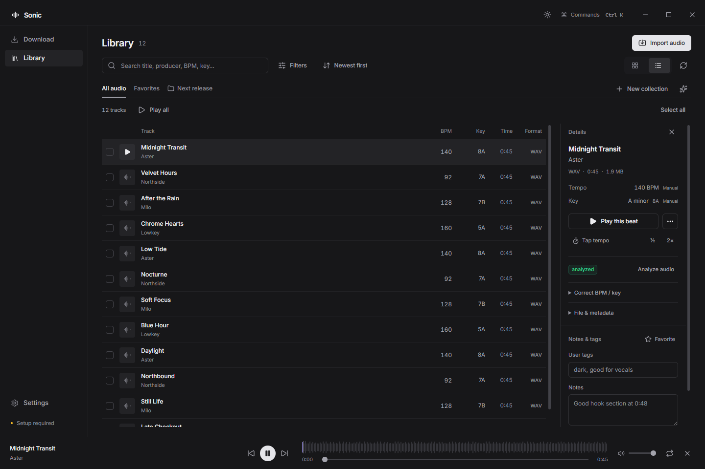
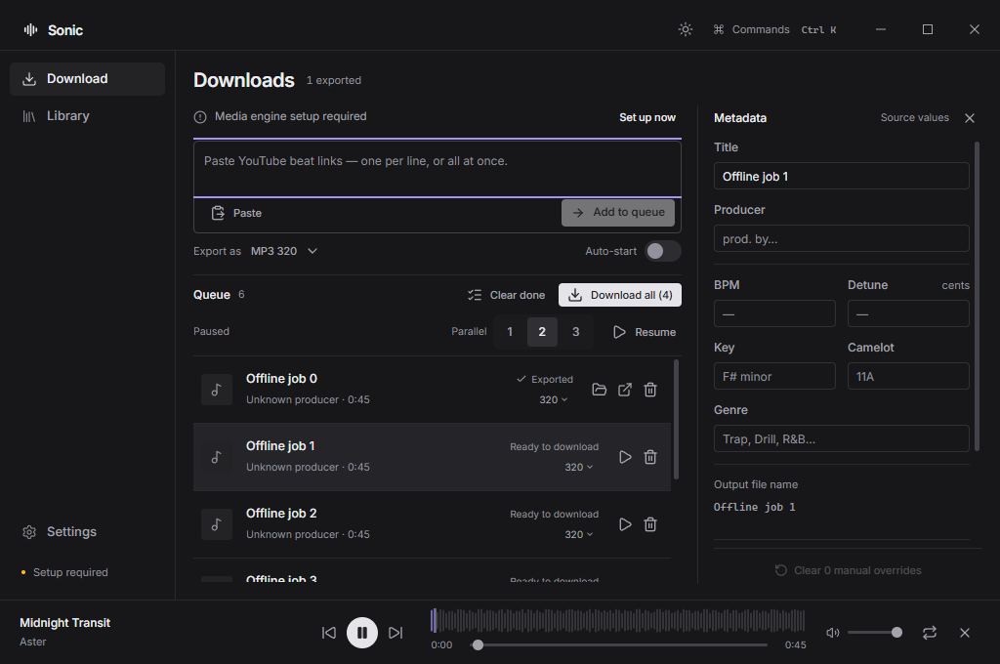

<p align="center">
  
</p>

<h1 align="center">Sonic V2</h1>

<p align="center">
  <strong>From a track link to your next session.</strong><br />
  Download, review, and organize audio for music production — on your Windows PC.
</p>

<p align="center">
  <a href="https://github.com/eterniastudio/sonic-v2/releases/latest"></a>
  <a href="#installation"></a>
  <a href="https://github.com/eterniastudio/sonic-v2/actions/workflows/verify.yml"></a>
</p>

<p align="center">
  <strong><a href="https://github.com/eterniastudio/sonic-v2/releases/latest">Download for Windows</a></strong> ·
  <a href="#your-first-track">Quick start</a> ·
  <a href="#building-from-source">Build from source</a> ·
  <a href="docs/CHANGELOG.md">Changelog</a>
</p>

<p align="center">
  <picture>
    <source media="(prefers-color-scheme: light)" srcset="docs/assets/ui-overhaul/library-light-1024.png" />
    
  </picture>
  <br />
  <sub>Your shortlist, musical metadata, and player in one workspace. Screenshots use demo tracks.</sub>
</p>

Sonic brings YouTube tracks, SoundCloud tracks, and your own audio into one local library.
Review tempo and key, correct the metadata, and export a file ready for your DAW.
Your library lives on your machine; there is no Sonic account, analytics, or conversion server.

## Built for the work between finding a track and making music

| What you need | What Sonic does |
| --- | --- |
| **Bring in a batch** | Paste multiple links, choose tracks from a YouTube playlist, or import local files and folders. |
| **Know where the BPM came from** | Distinguish source text, embedded tags, and local audio estimates. Review disagreements and keep your own corrections in control. |
| **Export for your session** | Choose from eight recipes, preview filenames, embed reviewed tags, and optionally normalize loudness. |
| **Build a useful shortlist** | Search by title, producer, BPM, key, or Camelot notation. Save favorites, notes, tags, and manual or rule-based collections. Analyze or re-export a selection together. |
| **Keep listening while you work** | Audition through a persistent waveform player. Playback continues across views; restarting restores your last track and position paused. Reconnect moved files without rebuilding your library. |

## Installation

**Requires Windows 10 or 11, 64-bit.** Node.js and Python are not required to use the installer.

1. Open the [latest release](https://github.com/eterniastudio/sonic-v2/releases/latest) and download the Windows `*-setup.exe` asset.
2. Run the installer. Choose an installation folder and launch **Sonic V2**.
3. Click **Set up now** in the media engine banner. Wait for setup to finish before adding your first download.

Sonic uses **yt-dlp** to acquire audio and **FFmpeg / ffprobe** to convert, tag, and inspect it.
These tools are installed separately from the app. Setup can download them into Sonic's app-data
folder or use tools already available on your machine. The yt-dlp download is verified against
its publisher's SHA-256 manifest. You can select your own executables under
**Settings → Media engine**.

## Your first track

1. **Choose an output.** In **Download**, pick an **Export as** recipe. MP3 320 is the default. Turn off **Auto-start** if you want to review metadata before downloading.
2. **Add a link.** Paste a supported track URL and select **Add to queue**, or press `Ctrl+Enter`. For a YouTube playlist, choose **Review playlists** and select the tracks you want.
3. **Review the metadata.** Select a queued track to inspect its title, producer, BPM, and key. With Auto-start off, choose **Download all** when you're ready.
4. **Open your audio.** Finished tracks appear in **Library** and in your Music folder's `Sonic V2` directory. Change the destination in **Settings → Export**. Open the export folder from `Ctrl+K` to bring files into your DAW.

Already have the files? Choose **Library → Import audio**. Sonic references imported audio
in place and leaves the originals untouched. Re-export to create a separate copy with your
reviewed tags.

<details>
<summary><strong>See the download workspace</strong></summary>

<p align="center">
  
</p>

</details>

## Supported sources

| Source | Accepted input |
| --- | --- |
| **YouTube** | Individual videos, Shorts, embeds, and live-replay links. Playlists open a track selection review. |
| **SoundCloud** | Individual tracks, private share URLs containing an `s-…` token, and `on.soundcloud.com` share links. Playlists and profiles are unsupported. |
| **Local audio** | Files or folders added through **Import audio**. Originals stay in their existing location. |

YouTube playlist reviews read up to the first **500 entries per playlist** and skip unavailable
or duplicate entries. Other websites and direct-file URLs are not accepted by this version.
If a SoundCloud short link has expired, use the full track URL instead.

Browser cookies are off by default. If an authorized source needs a signed-in session, choose
**Settings → Media engine → Use cookies from a browser**. Availability still depends on the
source and yt-dlp's support for it.

> **Use responsibly.** Download only media you own or have permission to download.
> Sonic does not bypass DRM or access restrictions and is not affiliated with YouTube or SoundCloud.

## Tempo and key you can inspect

A BPM or key is useful only if you know how it was obtained. Sonic keeps four sources of
metadata separate and shows their origin in the inspector.

| Source | What it means |
| --- | --- |
| **Source text** | A declaration parsed from a title, description, or filename, such as `144 BPM` or `F# minor`. |
| **Embedded tags** | Metadata already written into the audio container. |
| **Audio estimate** | Tempo or key measured from decoded audio by Sonic's local analyzer. |
| **Your correction** | A value you type, tap, or explicitly adopt. It takes precedence. |

Automatic reconciliation follows **manual correction → source text → embedded tag → audio estimate**.
Audio estimates fill gaps; they do not silently replace declared values. When sources disagree,
the inspector keeps the evidence so you can choose. Reanalysis preserves manual corrections.

The analyzer can report alternatives or **inconclusive** results. Its confidence indicator is
not a probability of correctness. Confirm the tempo and key before relying on them in a session;
a BPM in a filename does not set your DAW's project tempo.

For the algorithms, test fixtures, and measured limits, read the
[audio analysis review](docs/IMPROVEMENTS-2026-10-14.md).

## Export formats

| Recipes | Output | Useful for |
| --- | --- | --- |
| **MP3 320 · MP3 V0** | Constant 320 kbps or high-quality variable-bitrate MP3 | Sharing and broad player compatibility |
| **M4A AAC 256 · Opus 192** | AAC at 256 kbps or Opus at 192 kbps | Compact listening copies |
| **FLAC** | Lossless compression | Keeping decoded audio without another lossy encode |
| **WAV 44.1 / 24 · WAV 48 / 24** | 24-bit PCM at 44.1 or 48 kHz | DAW sessions and editing |
| **Original stream** | Acquired audio without re-encoding | Preserving the downloaded stream |

Converting a lossy source to WAV or FLAC does not restore lost detail. Choose the format
your workflow needs.

Processed exports can preserve channels or force stereo or mono, optionally normalize to a
LUFS target, and embed reviewed metadata. Cover embedding depends on the output format.
Original stream skips re-encoding and loudness normalization.

Set a naming template in **Settings → Export** and check its live preview. For example:

```text
{producer} - {title} [{bpm} BPM] [{key}]
Aster - Midnight Transit [140 BPM] [A minor].wav
```

Known BPM and key values are included even when a custom template omits their tokens.
Later corrections can safely rename Sonic-owned exports; they do not rewrite existing audio
tags. **Re-export** when you want the corrected tags in a new file. Optional JSON sidecars
preserve metadata and source provenance alongside your exports.

## Everyday controls

| Task | Where to find it |
| --- | --- |
| Search tracks, navigate, or run an action | `Ctrl+K` opens the command palette. |
| Add the links you've pasted | `Ctrl+Enter` in the link field. |
| Listen to a shortlist | **Play selected** or **Play results** in Library. |
| Reconnect moved audio | **Locate file…** for one track or **Find missing files…** for a batch. |
| Retry a download | **Retry** on the failed queue item. |

## Privacy and local storage

Analysis, conversion, playback, and library storage run on your computer. Network access is
used for inspecting or downloading links, installing the media engine, and fetching artwork.
Optional browser-cookie access is handled by yt-dlp using the browser you select.

Application state lives in `%APPDATA%\Sonic V2\`. Open it through
**Settings → Advanced → Open app data folder**.

| Files or folders | Contents |
| --- | --- |
| `settings.json` · `playback-session.json` | Preferences, last track, volume, and saved listening positions |
| `library.json` · `organization.json` | Track records, source links, artwork URLs, notes, tags, and collections |
| `queue.json` · `analysis-cache.json` | Saved queue and audio analysis cached by file content and analyzer version |
| `engine\` · `covers\` | Managed media tools and cached artwork |
| `staging\` · `analysis\` | Temporary downloads, conversions, and decoded analysis audio |

The queue is saved after a short debounce; interrupted jobs become resumable on the next
launch. Finished audio lives in your chosen export folder, and imported originals stay where
you put them. A backup needs both the app-data folder and the audio folders it references.

## Troubleshooting

| Problem | Try this |
| --- | --- |
| Media engine is missing or setup failed | Open **Settings → Media engine → Set up / repair engine**. Use **Browse** to select an installed tool if needed. |
| A download needs sign-in | For a source you are allowed to access, select **Use cookies from a browser** in Media engine settings, then retry the job. |
| A track is marked missing | Use **Locate file…** or **Find missing files…** to reconnect it while keeping its library details. |
| BPM or key looks wrong | Inspect the source and audio evidence, then enter or adopt a correction. Re-export if the file's tags need updating. |

Still stuck? [Open an issue](https://github.com/eterniastudio/sonic-v2/issues) with your Sonic
version, Windows version, the exact error, and steps to reproduce. Remove private links and
personal file paths before sharing diagnostics.

## Building from source

Use **Windows x64, [Node.js 24](https://nodejs.org/), and npm** to match CI.
The repository uses `package-lock.json`.

```powershell
git clone https://github.com/eterniastudio/sonic-v2.git
cd sonic-v2
npm ci
npm run dev
```

| Command | Result |
| --- | --- |
| `npm run dev` | Electron and the Vite development server with hot reload |
| `npm run build` | Compiled main, preload, and renderer in `out/` |
| `npm run package` | Unpacked Windows x64 app in `release/` |
| `npm run dist` | Windows x64 NSIS installer in `release/` |

The app version comes from [`package.json`](package.json). Installer configuration and naming
live in [`electron-builder.yml`](electron-builder.yml). This checkout targets Windows x64;
macOS and Linux desktop builds are not supported.

### Checks and contributing

Create a branch from `main`, make your change, and run the same checks as the
[Windows verification workflow](.github/workflows/verify.yml):

```powershell
npm run typecheck
npm run test:unit
npm run test:key
npm run build
```

For interface changes, `npm run test:ui:hidden` drives the real app with its windows hidden.
Native window and OS pointer checks require a visible Windows desktop and `npm run test:ui`.
These UI suites run separately from the verification workflow.

In your pull request, explain the user-visible change and how you verified it. Reports and
fixes for download reliability, metadata, accessibility, and library workflows are welcome.

<details>
<summary><strong>Codebase map</strong></summary>

Sonic V2 is an Electron application built with React and TypeScript, with no code carried
over from the earlier Tauri application.

| Directory | Responsibility |
| --- | --- |
| [`src/main`](src/main) | Electron lifecycle, file access, media tools, queue, library, and audio analysis |
| [`src/preload`](src/preload) | Typed, allow-listed bridge between the renderer and main process |
| [`src/shared`](src/shared) | Domain types, URL validation, metadata parsing, music notation, export recipes, and naming |
| [`src/renderer/src`](src/renderer/src) | React interface, playback, settings, and Zustand state |
| [`tests`](tests) · [`scripts`](scripts) | Regression tests, analysis fixtures, benchmarks, and app verification tools |

The renderer runs sandboxed with context isolation and no Node integration. Privileged
operations belong to the main process. Local playback uses the `sonic-media:` protocol,
which resolves library IDs to files.

</details>

## Project notes

| Read more | What it covers |
| --- | --- |
| [Changelog](docs/CHANGELOG.md) | Features, fixes, and links to earlier verification work |
| [Audio analysis](docs/IMPROVEMENTS-2026-10-14.md) | Tempo and key detection, benchmarks, and known limits |
| [Library performance](docs/PERFORMANCE-REVIEW-2026-10-04.md) | Search, playback updates, and measured behavior |
| [Local imports](docs/LOCAL-IMPORT-VERIFICATION-2026-09-23.md) | How imported originals are protected |
| [File recovery](docs/RECOVERY-VERIFICATION-2026-10-04.md) | Reconnecting moved audio and preserving library records |

## License

No project `LICENSE` file is included in this checkout, although `package.json` refers to one.
The source does not currently include a license granting permission to reuse, modify, or
redistribute it; contact the copyright holder, **Eternia Studios**, for permission.

The bundled Inter font is covered separately by the
[SIL Open Font License](src/renderer/public/licenses/Inter-OFL.txt).
