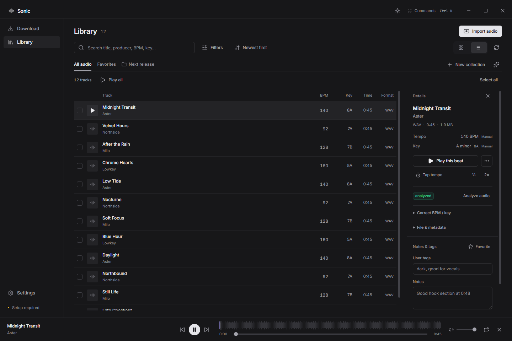
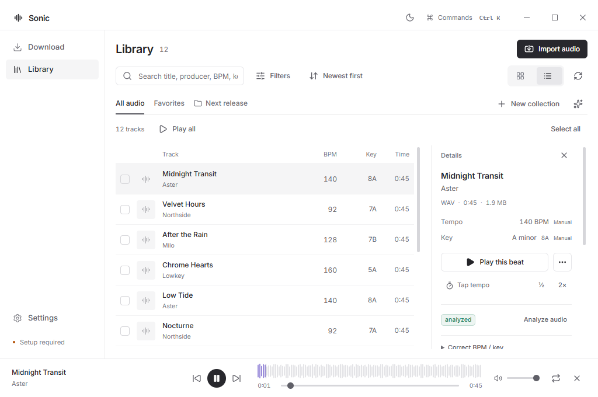
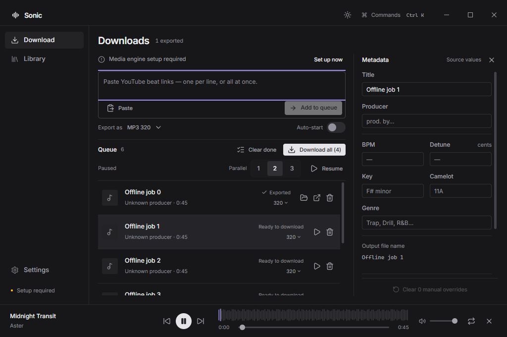
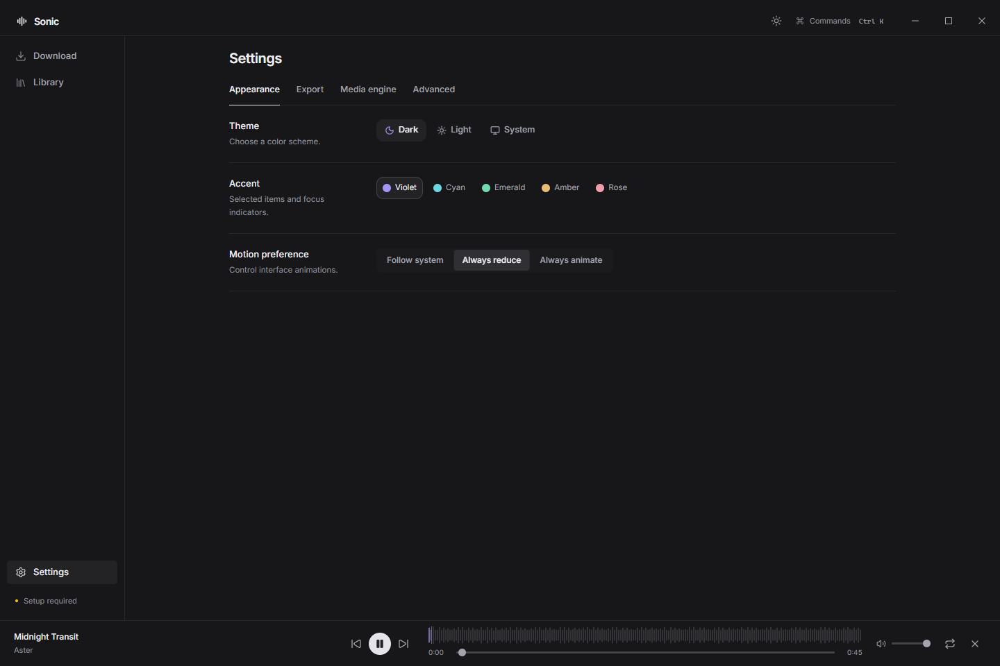

# Sonic minimal workspace UI

Sonic uses a flat, monochrome workspace with compact controls and locally bundled Inter typography. The layout covers Library, Downloads, Settings, and the persistent player at both standard and minimum desktop sizes.

## What changed

- The 180px sidebar and unframed content area use neutral surfaces, quiet selection states, thin dividers, and compact headings. The persistent player is 66px high in its normal state.
- Library opens in a 52px-row list for new workspaces. Existing saved layout preferences remain intact. Collection tabs use underlines; metadata, corrections, notes, and tags sit in a separate scrolling inspector. Grid view uses compact horizontal tiles and real source artwork when available.
- Downloads has one outlined link composer, inline export preferences and setup status, 68px queue rows, and a flat metadata inspector. The inspector remains beside the composer at 1024 × 680 and stays dismissed until another job becomes available.
- Settings uses plain preference rows and compact theme choices. Shared buttons, inputs, segments, focus outlines, and light/dark colors follow the same restrained system. Inter and its OFL license are included in the built app, so typography does not depend on a network connection.

The four implementation areas were delegated to separate agents. Integration, screenshot review, and verification were performed together. [Hallmark's skill](https://github.com/nutlope/hallmark/blob/main/skills/hallmark/SKILL.md) and its relevant design guidance were read remotely. No skill was downloaded, installed, or copied into the repository.

## Behavior and scope

This PR is stacked on the Library workspace continuity change in PR #7. Library search, filters, selection, range anchor, scroll, and inspector restoration remain separate from the captured playback queue. Navigation does not submit pending metadata/annotation drafts or reopen action dialogs. Import, export, correction, collection, queue, theme, and native-window controls retain their operations and accessible names.

The only main-process change is the default Library layout for a new organization record, from grid to list. Existing persisted views are not rewritten. IPC contracts, storage formats, download services, and analysis algorithms are unchanged. Missing tracks show an accessible explanation, and command-palette scrolling respects the effective reduced-motion preference.

## Verification

Typechecking and the production build passed. The final regression run passed 43 cases in 4.6 minutes, with one native Windows pointer test skipped and no retries or unexpected failures. This includes eight component cases, all five Library workspace cases, collections, real playback, interaction checks, and both visual/contrast cases. Local report: `test-results/reports/1790302056233-b0dfcafb-24c4-4590-85be-bc70db0ff126.json`.

The native pointer test could not acquire Windows foreground input. Chromium pointer tests for window controls, including button edges, passed. Primary-button text exceeded 4.5:1 contrast in all 20 theme/accent/hover combinations, and keyboard focus retained a visible 2px outline.

```powershell
npm run typecheck
npm run build
node scripts/build-component-harness.mjs
npx playwright test tests/ui-redesign.spec.mjs tests/components.spec.mjs tests/library-workspace.spec.mjs tests/interactions.spec.mjs tests/collections.spec.mjs tests/playback.spec.mjs
```

The UI cases use isolated temporary profiles and generated WAV fixtures. They check both themes at 1440 × 960 and 1024 × 680, default list selection, locally loaded Inter, horizontal overflow, unobstructed queue submission, visible player controls, theme-control containment, slider targets of at least 24px, inspector dismissal/reopening, and primary-button contrast across all five accents at rest and on hover. This is targeted contrast coverage, not a full accessibility audit. Packaged/installed-app execution is outside this verification.

## Screenshots

These captures show the running Electron app with generated fixture audio and sample titles, not the user's music library.

Library, dark theme, 1440 × 960:



Library, light theme, minimum window:



Downloads, minimum window:



Settings, dark theme:


